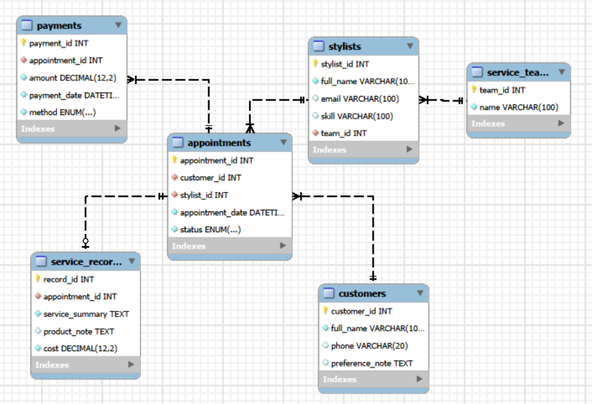

# Hair Salon Management System

**IST2610 – Database Management | Group 1 | Midterm Project**

Hoang Viet Hung - 11230749

Ninh Thi Minh Thuy - 11230779

Chu Viet Anh - 11230730

## 1. Project Overview

This project develops a relational database management system for a hair salon using MySQL.

The system manages customers, hairstylists, service teams, appointments, completed services, and payments. It also supports operational reporting, employee performance analysis, and outstanding debt tracking.

The project demonstrates practical applications of SQL, including database design, data manipulation, JOIN operations, aggregation, subqueries, and views.

## 2. Project Objectives

- Design a relational database with appropriate primary and foreign keys.
- Maintain customer, stylist, and service team information.
- Track appointments and their completion status.
- Record completed services and associated costs.
- Support multiple payments for a single appointment.
- Analyze appointment activity and stylist performance.
- Calculate total service revenue and outstanding customer debts.
- Generate reusable reports using SQL views.

## 3. Technologies Used

- **Database:** MySQL
- **Development Tool:** MySQL Workbench
- **Language:** SQL
- **Database Name:** `salon_mini`

## 4. Repository Structure

```text
Hair-Salon-Management-System/
├── schema.sql
├── seed.sql
├── queries.sql
├── views.sql
├── schema.png
└── README.md
```

| File | Description |
|------|-------------|
| `schema.sql` | Creates the database, tables, and integrity constraints. |
| `seed.sql` | Inserts sample records and performs data validation. |
| `queries.sql` | Contains 10 SQL queries for operational analysis. |
| `views.sql` | Creates 3 reporting views for appointments, service teams, and customer debts. |
| `README.md` | Provides project documentation and execution instructions. |
| `schema.png` | ER diagram image |


## 5. Database Design

### Entity Relationship Diagram (ERD)

The following ER diagram illustrates the database structure, including the six relational tables, their primary keys, foreign keys, and relationships.



The database consists of six relational tables.

| Table | Description |
|-------|-------------|
| `service_teams` | Stores specialized hair service teams. |
| `stylists` | Stores hairstylist information, skills, and team assignments. |
| `customers` | Stores customer profiles and preferences. |
| `appointments` | Manages appointments, assigned stylists, and appointment statuses. |
| `service_records` | Records completed services, product notes, and confirmed costs. |
| `payments` | Records customer payments, payment dates, and payment methods. |

### Table Relationships

- One service team can have multiple stylists.
- Each stylist belongs to exactly one service team.
- One customer can have multiple appointments.
- Each appointment is assigned to one stylist.
- Each appointment can have at most one service record.
- One appointment can have multiple payments.

### Data Integrity Constraints

The database implements:

- `PRIMARY KEY` for unique record identification.
- `FOREIGN KEY` for referential integrity.
- `NOT NULL` for mandatory information.
- `UNIQUE` for selected attributes and service record relationships.
- `CHECK` for non-negative service costs and positive payment amounts.
- `ENUM` for valid appointment statuses and payment methods.

**Appointment Statuses:**
- `Pending`
- `Completed`
- `Cancelled`

**Payment Methods:**
- `Cash`
- `BankTransfer`
- `Card`

Additional validation queries verify business rules involving appointment completion, confirmed costs, and payment totals.

## 6. Sample Dataset

The project includes simulated salon transactions covering 2024, 2025, and 2026.

| Table | Number of Records |
|-------|------------------:|
| Service Teams | 5 |
| Stylists | 7 |
| Customers | 11 |
| Appointments | 20 |
| Service Records | 14 |
| Payments | 15 |

### Service Teams

1. Hair Cutting and Styling
2. Hair Coloring and Bleaching
3. Hair Perming and Straightening
4. Hair Care and Treatment
5. Hair Extensions

### Sample Data Scenarios

The dataset includes:

- Completed, Pending, and Cancelled appointments.
- Transactions within and outside Q1 2025.
- Transactions outside the year 2025.
- Customers with multiple completed appointments.
- Appointments with multiple payment installments.
- Partially paid appointments and outstanding debts.
- Customers without payment records.
- Service teams without appointments in Q1 2025.
- Stylists without appointments in 2025.

All customer and employee information is fictional and used for educational purposes.

## 7. SQL Queries

The `queries.sql` file contains 10 independent SQL queries.

| No. | Query Description |
|-----|-------------------|
| 1 | List completed appointments in January 2025. |
| 2 | Count appointments by service team in Q1 2025. |
| 3 | Identify customers with appointments without service records, excluding cancelled appointments. |
| 4 | Calculate average service cost per completed appointment by team. |
| 5 | Identify the top 3 stylists with the most completed appointments in 2025. |
| 6 | Calculate total customer payments made in 2025. |
| 7 | Identify customers without any payment records. |
| 8 | Calculate total confirmed service costs for each customer. |
| 9 | Calculate each stylist's appointment cancellation rate in 2025. |
| 10 | Identify customers with more than 3 completed appointments in 2025. |

### SQL Concepts Applied

- `INNER JOIN` and `LEFT JOIN`
- `GROUP BY` and `HAVING`
- Aggregate functions: `COUNT()`, `SUM()`, `AVG()`
- `CASE WHEN`
- `COALESCE()` and `NULLIF()`
- `DISTINCT`
- `NOT EXISTS`
- `ORDER BY` and `LIMIT`
- Date-based filtering

## 8. Database Views

Three SQL views provide reusable reporting capabilities.

### 8.1. `v_detail`

Provides appointment-level information, including:

- Appointment ID and date
- Appointment status
- Customer information
- Assigned stylist
- Service team
- Confirmed service cost

Appointments without completed service records are retained, with `NULL` service costs.

### 8.2. `v_group_summary`

Summarizes salon activity by service team.

Includes:

- Total appointments
- Completed appointments
- Cancelled appointments
- Total confirmed service costs

All service teams are included, even when they have no appointments.

### 8.3. `v_debt`

Tracks each customer's financial obligations.

Includes:

- Total confirmed service costs
- Total payments received
- Outstanding debt

**Outstanding Debt = Total Confirmed Service Costs - Total Payments**

Service costs and payments are aggregated separately to prevent duplicate cost calculations when appointments have multiple payments.

## 9. Sample Results

The following results are calculated from the simulated dataset.

### Appointment Summary

| Status | Number of Appointments |
|--------|-----------------------:|
| Completed | 14 |
| Pending | 3 |
| Cancelled | 3 |
| **Total** | **20** |

### Financial Summary

| Metric | Amount (VND) |
|--------|-------------:|
| Total Confirmed Service Costs | 12,560,000 |
| Total Payments Received | 12,010,000 |
| Outstanding Debt | 550,000 |

### Outstanding Debt Example

One customer has an outstanding balance:

| Customer | Service Cost | Amount Paid | Outstanding Debt |
|----------|-------------:|------------:|-----------------:|
| Pham Van Nam | 950,000 | 400,000 | 550,000 |

These results demonstrate how the system tracks confirmed service costs, actual payments, and unpaid balances.

## 10. How to Run

### Prerequisites

- MySQL Server
- MySQL Workbench

### Execution Steps

**Step 1:** Open MySQL Workbench and connect to your MySQL Server.

**Step 2:** Open and execute `schema.sql` to create the `salon_mini` database and its six tables.

**Step 3:** Execute `seed.sql` to insert sample data and validate database integrity.

**Step 4:** Execute `queries.sql` to run the 10 analytical queries.

**Step 5:** Execute `views.sql` to create the reporting views.

Execute the files in the following order:

```text
schema.sql
    ↓
seed.sql
    ↓
queries.sql
    ↓
views.sql
```

### Verify the Results

After creating the views, run:

```sql
USE salon_mini;

SELECT * FROM v_detail;

SELECT * FROM v_group_summary;

SELECT * FROM v_debt;
```

To verify the overall financial results:

```sql
SELECT
    SUM(total_service_cost) AS total_service_cost,
    SUM(total_paid) AS total_paid,
    SUM(outstanding_debt) AS total_outstanding_debt
FROM v_debt;
```

**Note:** The scripts are intended to run in sequence on a newly created database. Re-executing the setup or sample data scripts without resetting the database may cause duplicate object or primary key errors.

## 11. Project Scope and Limitations

The system focuses on basic hair salon operations and relational database management.

The project does not include:

- Inventory management
- Individual product consumption tracking
- Employee payroll management
- Online booking interfaces
- Payment refunds or advance payments
- Automated enforcement of cross-table financial constraints using triggers

Cross-table business rules are verified through validation queries in `seed.sql`.

## 12. Conclusion

This project demonstrates the design and implementation of a relational database for hair salon management using MySQL.

Through database normalization principles, relational constraints, SQL queries, and reporting views, the system supports appointment management, service performance analysis, and customer debt monitoring.

The project provides a foundation for developing more advanced salon management applications.

---

**Course:** IST2610 – Database Management  
**Project:** Midterm – Hair Salon Management System  
**Group:** 1  
**Database:** MySQL
